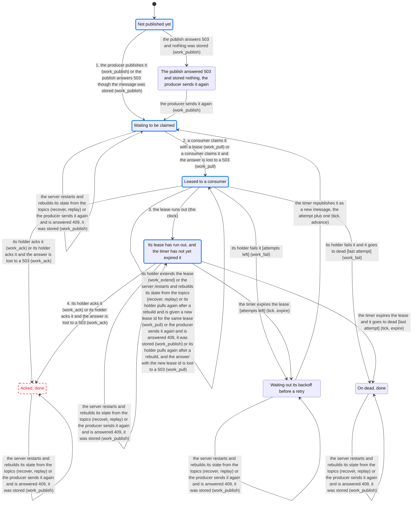

# One work item, two consumers, up to 2 attempts, with an ack accepted on an expired lease (a seeded bug)

Checked by `cargo test -p mansio-models`, which fails when this file is stale; `UPDATE_CHARTS=1 cargo test -p mansio-models` redraws it.

## Rules

- always: an item has at most one live lease: **holds** (ARCHITECTURE.md, Work items, Claim)
- always: an ack or extend with a lease that is not live is refused: **broken** (ARCHITECTURE.md, Work items, Extend and Ack)
- always: an item is acked at most once: **holds** (README, The guarantee)
- always: an item past the attempt cap is in dead and nowhere else: **holds** (ARCHITECTURE.md, Work items, Fail)
- eventually: every item ends acked or dead: **holds** (README, The guarantee)
- sometimes: an item is acked after a retry: **holds** (ARCHITECTURE.md, Work items, Fail, and State)
- sometimes: an item reaches dead: **holds** (ARCHITECTURE.md, Work items, Fail)

"an ack or extend with a lease that is not live is refused" is broken. The shortest path that breaks it:

```text
  start: Not published yet
  1. the producer publishes it (work_publish) -> Waiting to be claimed
  2. a consumer claims it with a lease (work_pull) -> Leased to a consumer
  3. the lease runs out (the clock) -> Its lease has run out, and the timer has not yet expired it
  4. its holder acks it (work_ack) -> Acked, done
```

## Chart

1934 states checked. An arrow lists every step that takes an item from one state to the other. Red: every item in that state breaks a rule. Red and dashed: some items in it do. Blue: the shortest path to the first broken rule, its steps numbered.


